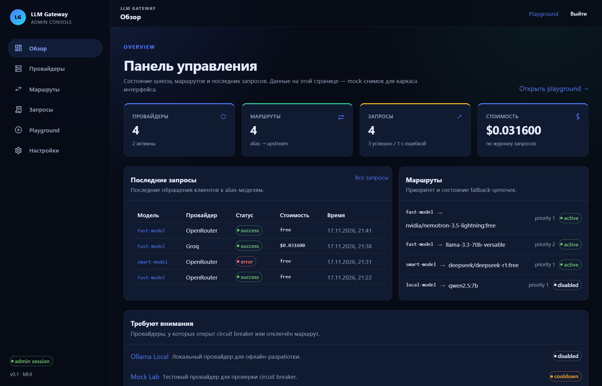
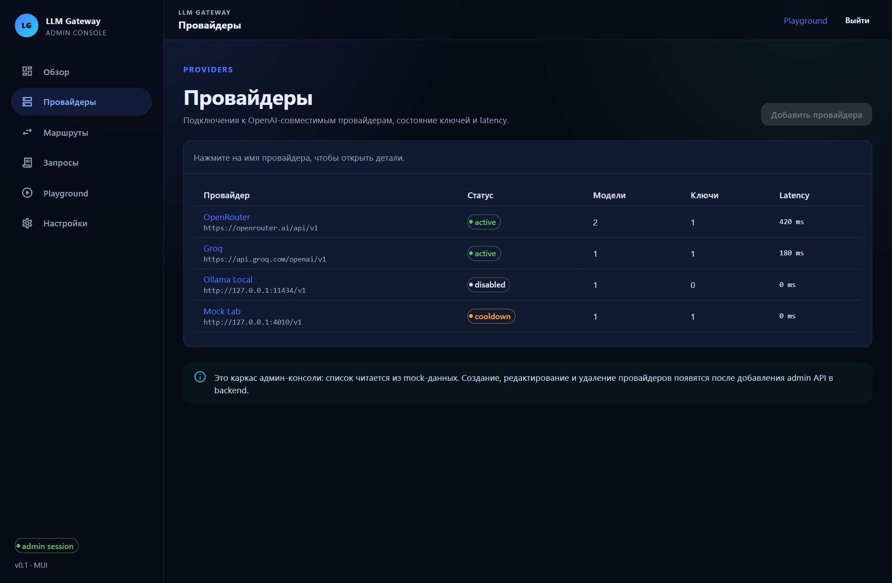
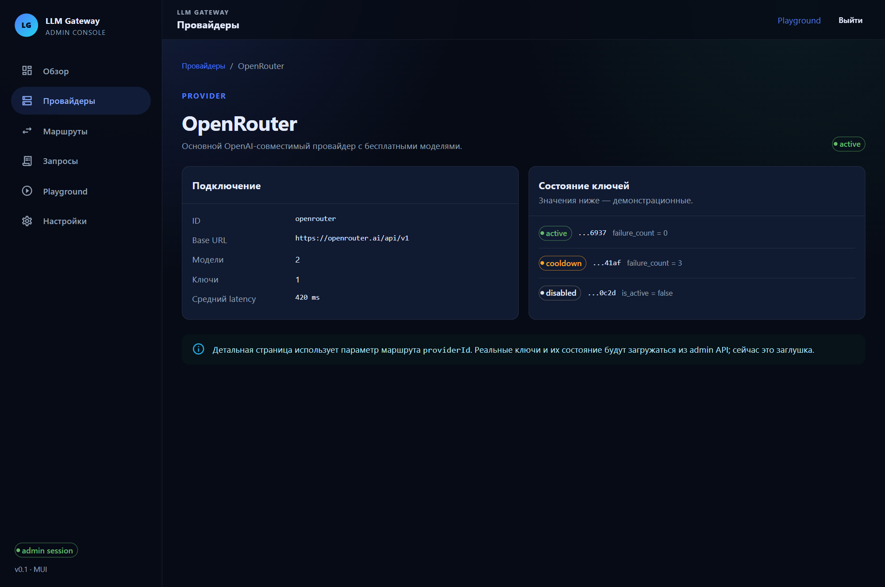
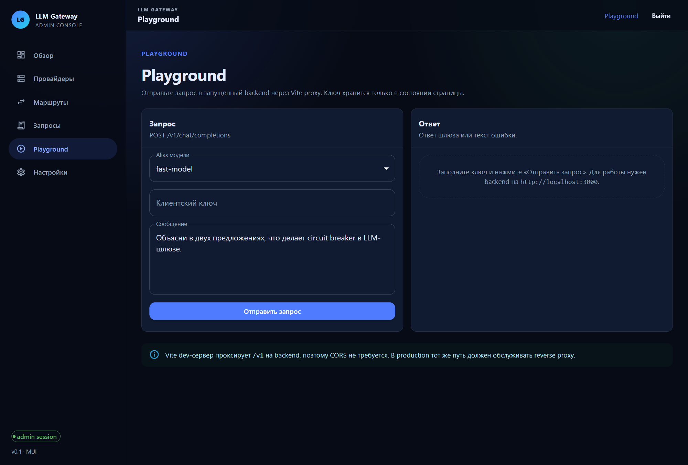
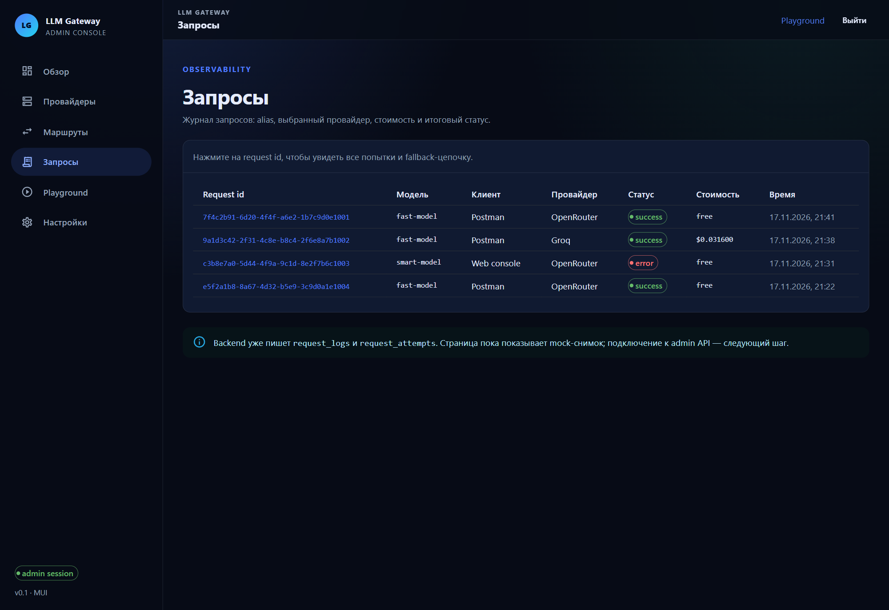
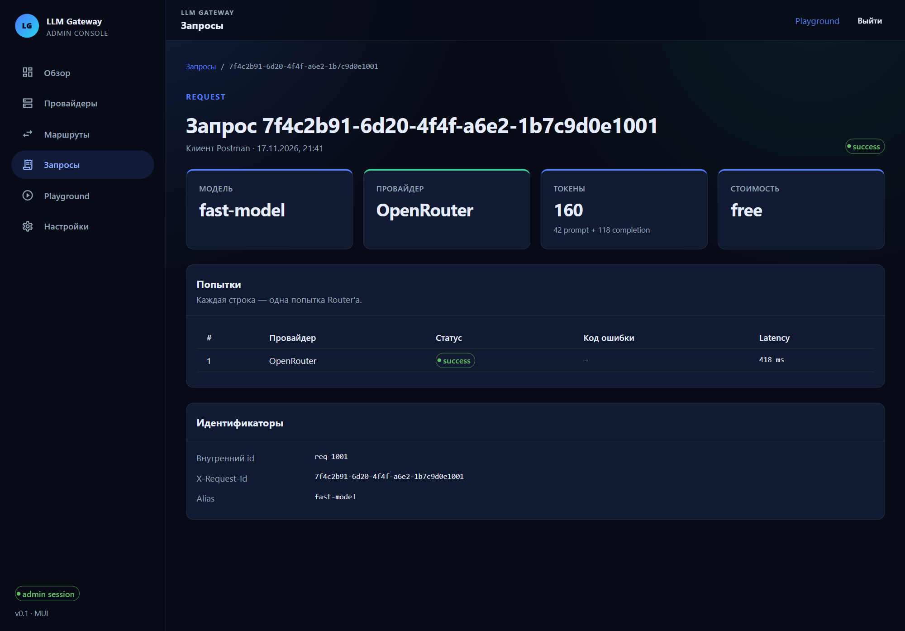
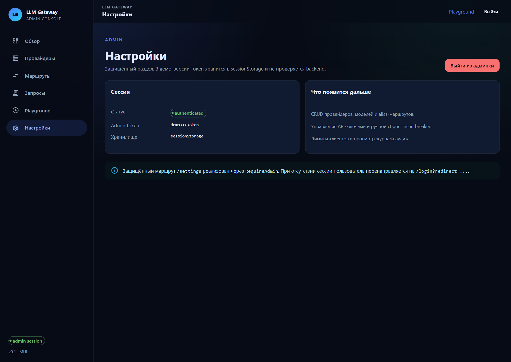

# Unified LLM Gateway

Учебный проект: шлюз к LLM-провайдерам с единым OpenAI-совместимым API,
ротацией API-ключей, fallback-цепочками и журналом запросов.

## Стек

- Node.js 22+ (локально проверено на Node.js 24)
- TypeScript, ESM
- Fastify 5
- Zod 4
- PostgreSQL 17 в Docker
- Drizzle ORM
- Pino
- Vitest
- React 19 + MUI 7 (Material UI) в веб-консоли

## Веб-консоль

В репозитории три самостоятельных проекта:

- **backend** — Fastify-шлюз в корне репозитория;
- **frontend** — React-консоль в `web/frontend`;
- **ui-library** — библиотека общих компонентов в `web/ui-library`.

Интерфейс собран на [MUI](https://mui.com/material-ui/): тёмная тема
описана в `web/frontend/src/theme.ts`, layout построен на `Drawer` и
`AppBar`, таблицы — на `Table`, формы — на `TextField`. Библиотека
`@llm-gateway/ui` — это обёртки над MUI (`Button`, `Card`,
`StatusBadge`, `PageHeader`, `StatCard`, `EmptyState`), поэтому обе
части приложения выглядят одинаково.

Подробная структура, список библиотек и роутинг описаны в
[`architecture.md`](architecture.md). Границы MVP и use case — в
[`mvp.md`](mvp.md).

### Запуск веб-консоли

Сначала запустите backend по инструкции ниже. Затем установите
зависимости и соберите библиотеку:

```sh
cd web/ui-library
npm install
npm run build
```

После этого запустите frontend:

```sh
cd ../frontend
npm install
npm run dev
```

Команды `dev`, `build` и `test` frontend сами пересобирают библиотеку
через `predev`, `prebuild` и `pretest`, поэтому отдельный `npm run build`
нужен только для первой проверки.

Откройте `http://localhost:5173`. Vite проксирует запросы `/v1` на
`http://localhost:3000`, поэтому playground работает без CORS.

Проверки обоих frontend-проектов:

```sh
cd web/ui-library
npm run lint && npm run test:coverage && npm run build

cd ../frontend
npm run lint && npm run test:coverage && npm run build
```

### Скриншоты

Панель управления с mock-снимком состояния шлюза:



Список провайдеров:



Детали провайдера с параметром маршрута:



Playground для реального запроса через backend:



Журнал запросов:



Детали запроса и fallback-попытки:



Защищённый раздел настроек:



> Скриншоты сделаны на каркасе с mock-данными. Интерфейс построен на
> MUI 7 с тёмной темой, компоненты взяты из `@llm-gateway/ui`. Реальные
> провайдеры, ключи и журнал будут подключены через admin API в
> следующих инкрементах.
## Быстрый старт

```sh
npm install
docker compose up -d
```

Создайте `.env` на основе `.env.example` и сгенерируйте мастер-ключ:

```powershell
Copy-Item .env.example .env
node -e "console.log(require('crypto').randomBytes(32).toString('base64'))"
```

Полученное значение подставьте в `ENCRYPTION_KEY`. Docker Desktop должен быть
запущен, иначе `docker compose up -d` не сможет подключиться к демону.

Примените миграции:

```sh
npm run db:migrate
```

Заполните `OPENROUTER_API_KEY` в `.env` и создайте тестовые данные:

```sh
npm run db:seed
```

Скрипт идемпотентен: создаёт провайдера OpenRouter, бесплатную модель,
alias `fast-model` и зашифрованный ключ. Повторный запуск не создаёт дубликаты.

Создайте клиента шлюза и сохраните выведенный API-ключ:

```sh
npm run db:create-client -- "Postman" 60
```

Второй аргумент — лимит запросов в минуту. Ключ печатается один раз:
в базе лежит только его SHA-256-хэш.

Запуск в режиме разработки:

```sh
npm run dev
```

Проверка:

```sh
curl http://localhost:3000/health
curl http://localhost:3000/ready
```

## API

### `POST /v1/chat/completions`

Запрос требует клиентский ключ в заголовке `Authorization: Bearer ...`.
Ключ создаётся командой `npm run db:create-client` и печатается один раз.

#### curl (bash / macOS / Linux)

```sh
export CLIENT_KEY="lgw_..."

curl -sS http://localhost:3000/v1/chat/completions \
  -H "Authorization: Bearer $CLIENT_KEY" \
  -H "Content-Type: application/json" \
  -d '{"model":"fast-model","messages":[{"role":"user","content":"Hello!"}]}'
```

#### curl.exe (Windows PowerShell)

```powershell
$env:CLIENT_KEY = "lgw_..."

curl.exe -sS -X POST http://localhost:3000/v1/chat/completions `
  -H "Authorization: Bearer $env:CLIENT_KEY" `
  -H "Content-Type: application/json" `
  -d '{"model":"fast-model","messages":[{"role":"user","content":"Hello!"}]}'
```

Для кириллицы в Windows PowerShell надёжнее отправить UTF-8-файл:

```powershell
$json = @'
{
  "model": "fast-model",
  "messages": [
    { "role": "user", "content": "Привет!" }
  ]
}
'@

[System.IO.File]::WriteAllText(
  (Join-Path $PWD "body.json"),
  $json,
  (New-Object System.Text.UTF8Encoding($false))
)

curl.exe -sS -X POST http://localhost:3000/v1/chat/completions `
  -H "Authorization: Bearer $env:CLIENT_KEY" `
  -H "Content-Type: application/json; charset=utf-8" `
  --data-binary "@body.json"
```

Формат запроса и ответа совместим с OpenAI Chat Completions. Поле `model` —
это alias из `model_routes`, а не имя upstream-модели.

Аутентификация устроена так:

1. Клиент присылает `Authorization: Bearer <client_key>`.
2. Шлюз считает SHA-256 от ключа.
3. Ищет активную запись в `clients` по `key_hash`.
4. Если клиента нет или он деактивирован — возвращает `401`.

Сам ключ в БД не хранится: только `key_hash` и короткий `key_prefix`.
Поэтому потерянный ключ нельзя восстановить, можно только создать нового
клиента.

### Rate limit

У каждого клиента есть `rate_limit_rpm` (по умолчанию 60). Шлюз использует
in-memory счётчик с фиксированным окном 60 секунд. Лимит проверяется после
аутентификации и до валидации тела запроса.

При превышении возвращается:

```http
HTTP/1.1 429 Too Many Requests
Retry-After: 42
X-RateLimit-Limit: 60
X-RateLimit-Remaining: 0
X-RateLimit-Reset: 1800000000
```

```json
{
  "error": {
    "message": "Rate limit exceeded: 60 request(s) per minute",
    "type": "rate_limit_error",
    "code": "rate_limited"
  }
}
```

На успешных ответах тоже есть заголовки:

```text
X-RateLimit-Limit: 60
X-RateLimit-Remaining: 59
X-RateLimit-Reset: 1800000000
```

`X-RateLimit-Reset` — Unix-время в секундах, когда окно сбросится.

Ограничение текущей реализации: счётчики живут в памяти процесса. Если
запустить несколько экземпляров шлюза, у каждого будет свой лимит. Для
горизонтального масштабирования счётчики нужно вынести в Redis.

### Журнал запросов

Каждый запрос, дошедший до Router, сохраняется в две таблицы:

- `request_logs` — итог запроса: клиент, alias, фактическая модель,
  провайдер, ключ, токены, стоимость, latency, статус и код ошибки;
- `request_attempts` — каждая фактическая попытка Router'а: провайдер,
  ключ, HTTP-статус, ошибка и latency.

Запрос и его попытки пишутся одной транзакцией. Если вставка попыток
упадёт, запись о запросе тоже откатится: в журнале не появится запрос
без истории fallback'а.

Каждый ответ получает заголовок:

```http
X-Request-Id: 6f1c2a7e-0f6b-4a9c-9d7e-3b5a1c8e2d40
```

Это внутренний идентификатор запроса. По нему можно найти запись:

```sh
docker compose exec postgres psql -U gateway -d llm_gateway -c \
  "select request_id, requested_model, actual_model, status, error_code, cost_micros, latency_ms from request_logs order by created_at desc limit 5;"
```

И попытки этого запроса:

```sh
docker compose exec postgres psql -U gateway -d llm_gateway -c \
  "select a.attempt_no, a.status, a.http_status, a.error_code, a.latency_ms from request_attempts a join request_logs l on l.id = a.request_log_id where l.request_id = '6f1c2a7e-0f6b-4a9c-9d7e-3b5a1c8e2d40' order by a.attempt_no;"
```

Посмотреть `X-Request-Id` в ответе:

```sh
curl -i -sS http://localhost:3000/v1/chat/completions \
  -H "Authorization: Bearer $CLIENT_KEY" \
  -H "Content-Type: application/json" \
  -d '{"model":"fast-model","messages":[{"role":"user","content":"Hello!"}]}'
```

В PowerShell:

```powershell
curl.exe -i -sS -X POST http://localhost:3000/v1/chat/completions `
  -H "Authorization: Bearer $env:CLIENT_KEY" `
  -H "Content-Type: application/json" `
  -d '{"model":"fast-model","messages":[{"role":"user","content":"Hello!"}]}'
```

Важные детали:

- `cost_micros` считается по ценам модели из `models` — см. раздел
  «Стоимость запросов» ниже;
- запросы, отклонённые до Router (`401`, `429`, `400`), в журнал не пишутся —
  они видны в логах приложения;
- запись журнала best-effort: если БД недоступна, клиент всё равно получит
  ответ провайдера, а ошибка сохранения попадёт в лог приложения;
- `X-Request-Id` возвращается на всех ответах, включая ошибки.

### Стоимость запросов

Цены хранятся в таблице `models` в микро-долларах за 1M токенов:

- `input_price_micros_per_1m` — входные токены (prompt);
- `output_price_micros_per_1m` — выходные токены (completion).

1 USD = 1 000 000 микро-долларов. Например, цена `$0.15 / 1M` — это
`150000` микро-долларов.

Формула:

```text
cost_micros = round(
  (prompt_tokens * input_price_micros_per_1m
   + completion_tokens * output_price_micros_per_1m) / 1_000_000
)
```

Результат округляется до ближайшего целого микро-доллара (`Math.round`).
Для учебного проекта этого достаточно; строгий биллинг обычно использует
`ceil` или более высокую точность.

Router считает стоимость после ответа адаптера: именно он знает, какой
deployment сработал и какие цены у выбранной модели. В streaming стоимость
добавляется в финальный чанк, потому что `usage` приходит только в нём.

Стоимость видна в трёх местах:

- в JSON-ответе — поле `cost_micros`;
- в последнем SSE-чанке — поле `cost_micros`;
- в `request_logs.cost_micros`.

Пример JSON-ответа:

```json
{
  "id": "chatcmpl-6f1c2a7e",
  "object": "chat.completion",
  "created": 1800000000,
  "model": "fast-model",
  "choices": [
    {
      "index": 0,
      "message": { "role": "assistant", "content": "Hello!" },
      "finish_reason": "stop"
    }
  ],
  "usage": {
    "prompt_tokens": 10,
    "completion_tokens": 2,
    "total_tokens": 12
  },
  "provider": "OpenRouter",
  "latency_ms": 842,
  "cost_micros": 3
}
```

Посмотреть стоимость последних запросов:

```sh
docker compose exec postgres psql -U gateway -d llm_gateway -c \
  "select request_id, requested_model, actual_model, prompt_tokens, completion_tokens, cost_micros, status from request_logs order by created_at desc limit 5;"
```

Проверить цены моделей:

```sh
docker compose exec postgres psql -U gateway -d llm_gateway -c \
  "select upstream_model, input_price_micros_per_1m, output_price_micros_per_1m from models;"
```

У бесплатной модели цены равны `0`, поэтому `cost_micros` тоже будет `0`.
Чтобы увидеть ненулевое значение, задайте цены вручную:

```sh
docker compose exec postgres psql -U gateway -d llm_gateway -c \
  "update models set input_price_micros_per_1m = 150000, output_price_micros_per_1m = 600000 where upstream_model = 'nvidia/nemotron-3.5-lightning:free';"
```

Цены читаются из БД при каждом запросе, перезапуск шлюза не нужен.
Не забудьте вернуть `0`, если хотите снова видеть бесплатные запросы:

```sh
docker compose exec postgres psql -U gateway -d llm_gateway -c \
  "update models set input_price_micros_per_1m = 0, output_price_micros_per_1m = 0 where upstream_model = 'nvidia/nemotron-3.5-lightning:free';"
```

Проверить `cost_micros` в ответе:

```sh
curl -sS http://localhost:3000/v1/chat/completions \
  -H "Authorization: Bearer $CLIENT_KEY" \
  -H "Content-Type: application/json" \
  -d '{"model":"fast-model","messages":[{"role":"user","content":"Hello!"}]}'
```

### Streaming (SSE)

Если в запросе указать `"stream": true`, шлюз отвечает не одним JSON,
а потоком Server-Sent Events:

```http
HTTP/1.1 200 OK
Content-Type: text/event-stream; charset=utf-8
Cache-Control: no-cache, no-transform
X-Accel-Buffering: no
X-Request-Id: 6f1c2a7e-0f6b-4a9c-9d7e-3b5a1c8e2d40
```

Формат чанков совместим с OpenAI:

```text
data: {"id":"chatcmpl-...","object":"chat.completion.chunk","created":...,"model":"fast-model","choices":[{"index":0,"delta":{"role":"assistant"},"finish_reason":null}]}

data: {"id":"chatcmpl-...","object":"chat.completion.chunk","created":...,"model":"fast-model","choices":[{"index":0,"delta":{"content":"При"},"finish_reason":null}]}

data: {"id":"chatcmpl-...","object":"chat.completion.chunk","created":...,"model":"fast-model","choices":[{"index":0,"delta":{},"finish_reason":"stop"}],"usage":{"prompt_tokens":3,"completion_tokens":2,"total_tokens":5},"cost_micros":1}

data: [DONE]

```

Что происходит внутри:

1. Адаптер отправляет провайдеру `stream: true` и
   `stream_options: { include_usage: true }`.
2. Router ждёт **первый чанк**. Пока его нет, ошибка провайдера ещё может
   запустить fallback на другой ключ или deployment.
3. После первого чанка HTTP-заголовки уже отправлены, поэтому fallback
   невозможен. Если поток сломается, клиент получит событие:

```text
event: error
data: {"error":{"message":"Provider stream failed","type":"api_error","code":"upstream_error"}}

data: [DONE]

```

4. Если клиент закрыл соединение, upstream-запрос отменяется через
   `AbortController`, а запись в журнале получает статус `cancelled`.
5. В `request_logs` пишутся `is_stream = true`, `ttft_ms` (время до первого
   токена), `latency_ms`, `usage`, `cost_micros`, `status` и все попытки
   Router'а.

#### curl (bash / macOS / Linux)

```sh
curl -N -sS http://localhost:3000/v1/chat/completions \
  -H "Authorization: Bearer $CLIENT_KEY" \
  -H "Content-Type: application/json" \
  -d '{"model":"fast-model","messages":[{"role":"user","content":"Hello!"}],"stream":true}'
```

`-N` отключает буферизацию curl: текст должен появляться постепенно.

#### curl.exe (Windows PowerShell)

```powershell
curl.exe -N -sS -X POST http://localhost:3000/v1/chat/completions `
  -H "Authorization: Bearer $env:CLIENT_KEY" `
  -H "Content-Type: application/json" `
  -d '{"model":"fast-model","messages":[{"role":"user","content":"Hello!"}],"stream":true}'
```

Проверить журнал streaming-запроса:

```sh
docker compose exec postgres psql -U gateway -d llm_gateway -c \
  "select request_id, status, is_stream, ttft_ms, latency_ms, total_tokens, cost_micros from request_logs order by created_at desc limit 5;"
```

Ограничения текущей реализации:

- `timeoutMs` deployment'а действует на весь поток, а не на паузу между
  чанками; для долгих ответов его нужно увеличить;
- heartbeat-комментарии (`: ping`) пока не отправляются;
- backpressure учитывается через `drain`, но без отдельного лимита буфера;
- `usage` в streaming зависит от провайдера: если он не прислал
  `stream_options`-чанк, токены будут `0`.

### Состояние ключей в БД

Раньше cooldown и invalid-состояние жили только в памяти `KeyPool`:
после перезапуска шлюз забывал, что ключ недавно получил `429`, и снова
пробовал его первым.

Теперь `api_keys` использует поля:

- `failure_count` — счётчик ошибок ключа;
- `cooldown_until` — до какого момента ключ не выдавать;
- `last_used_at` — когда ключ последний раз участвовал в запросе;
- `is_active` — `false` после `401/403`.

При создании пула `ApiKeyRepository` читает эти поля, а `KeyPool`
восстанавливает состояние:

- `cooldown_until` в будущем → ключ сразу в `cooldown`;
- `cooldown_until` в прошлом → ключ активен;
- `failure_count` и `last_used_at` восстанавливаются как есть.

Router сообщает об изменениях через `onKeyState`:

| Событие | Что пишется в БД |
|---|---|
| успех | `failure_count = 0`, `cooldown_until = null`, `last_used_at = now` |
| `429` | `cooldown_until = now + cooldownMs`, `failure_count += 1`, `last_used_at = now` |
| `401/403` | `is_active = false`, `failure_count += 1`, `cooldown_until = null`, `last_used_at = now` |
| другая ошибка (порог не достигнут) | `failure_count += 1`, `last_used_at = now` |
| другая ошибка (порог достигнут) | `failure_count += 1`, `cooldown_until = now + KEY_FAILURE_COOLDOWN_MS`, `last_used_at = now` |

`failure_count += 1` выполняется атомарно в SQL, поэтому параллельные
запросы не теряют инкременты.

Запись состояния — best-effort и не ждётся в горячем пути Router'а.
Если БД недоступна, ответ клиенту не ломается, а ошибка попадает в лог.

Посмотреть состояние ключей:

```sh
docker compose exec postgres psql -U gateway -d llm_gateway -c \
  "select id, key_hint, is_active, failure_count, cooldown_until, last_used_at from api_keys order by created_at;"
```

Сбросить cooldown и счётчик ошибок вручную:

```sh
docker compose exec postgres psql -U gateway -d llm_gateway -c \
  "update api_keys set cooldown_until = null, failure_count = 0;"
```

Важно: `PoolRegistry` кэширует пулы в памяти. Состояние загружается
при первом запросе к провайдеру после старта процесса. Если поменять
ключи или их состояние в БД, нужно перезапустить шлюз (или вызвать
`pools.refresh(providerId)`, когда появится админка).

Ограничение: при одновременных success и `429` для одного ключа
возможен last-write-wins для `cooldown_until`. Для учебного проекта
это приемлемо; строгая версия потребовала бы версионирования
или отдельной таблицы событий.

### Circuit breaker ключей

`429` и `401/403` — не единственные причины временно исключить ключ.
Провайдер может отвечать `5xx`, не отвечать по таймауту или быть
недоступным по сети. Повторять такие запросы одним и тем же ключом
бессмысленно: это только увеличивает latency и шанс получить новый
таймаут.

`KeyPool` реализует circuit breaker на уровне API-ключа:

- после `KEY_FAILURE_THRESHOLD` подряд ошибок (по умолчанию `3`)
  ключ переходит в `cooldown`;
- cooldown длится `KEY_FAILURE_COOLDOWN_MS` (по умолчанию `60_000`);
- пока breaker открыт, `acquire()` не выдаёт ключ;
- после истечения cooldown ключ снова доступен — это half-open;
- если следующий запрос опять падает, breaker открывается сразу,
  потому что `failure_count` уже выше порога;
- успешный запрос сбрасывает `failure_count = 0` и закрывает breaker.

Состояния:

```text
closed (active)
   │ N ошибок подряд
   ▼
open (cooldown)
   │ cooldown истёк
   ▼
half-open (active, failure_count сохранён)
   ├── успех → closed
   └── ошибка → open
```

Что считается ошибкой ключа:

| Ошибка | Действие |
|---|---|
| `429` | отдельный cooldown по `cooldownMs`, breaker не нужен |
| `401/403` | ключ помечается `invalid` |
| timeout, `5xx`, network | `failure_count += 1`, при пороге — cooldown |
| `400/422`, client disconnect | не считается ошибкой ключа |

Важно: `400/422` и отмена клиентом — это не проблема ключа, поэтому
они не приближают открытие breaker'а.

Настройки:

```env
KEY_FAILURE_THRESHOLD=3
KEY_FAILURE_COOLDOWN_MS=60000
```

Посмотреть, у каких ключей открыт breaker:

```sh
docker compose exec postgres psql -U gateway -d llm_gateway -c \
  "select key_hint, failure_count, cooldown_until from api_keys where cooldown_until is not null order by cooldown_until;"
```

Принудительно закрыть все breaker'ы:

```sh
docker compose exec postgres psql -U gateway -d llm_gateway -c \
  "update api_keys set cooldown_until = null, failure_count = 0;"
```

Ограничение: состояние breaker'а хранится в памяти `KeyPool` и
восстанавливается из `api_keys` при старте. В multi-instance
развёртывании у каждого процесса будет своё представление о cooldown;
для production нужен Redis или атомарные обновления в БД.

Чтобы запрос дошёл до OpenRouter, в БД должны быть:

- провайдер `OpenRouter` с `base_url = https://openrouter.ai/api/v1`;
- модель с нужным `upstream_model`;
- маршрут `alias → model`;
- активный ключ в `api_keys`.

`ADMIN_TOKEN` пока не используется: он предназначен для будущей админки.

## Скрипты

| Команда | Назначение |
|---|---|
| `npm run dev` | Запуск Fastify с горячей перезагрузкой |
| `npm run build` | Компиляция `src` в `dist` |
| `npm start` | Запуск собранного приложения |
| `npm run typecheck` | Проверка типов без сборки |
| `npm test` | Юнит- и интеграционные тесты |
| `npm run db:generate` | Генерация миграции Drizzle |
| `npm run db:migrate` | Применение миграций |
| `npm run db:seed` | Заполнение БД провайдером, моделью, alias и ключом |
| `npm run db:create-client` | Создание клиента и печать его API-ключа |
| `npm run db:studio` | Drizzle Studio |

## Структура

```text
src/
├── adapters/        # адаптеры провайдеров
├── auth/            # аутентификация клиентов по Bearer-ключу
├── config/          # валидация окружения
├── core/            # доменные типы и ядро маршрутизации
├── db/              # схема Drizzle, клиент и репозитории
├── routes/          # HTTP-маршруты, резолвер и сборка deployment'ов
├── app.ts           # сборка Fastify-приложения
└── index.ts         # точка входа
web/
├── frontend/        # React admin console
└── ui-library/      # библиотека общих компонентов
docs/                # пояснения и проектная документация
```

## OpenRouter и бесплатные модели

OpenRouter предоставляет OpenAI-совместимый endpoint:

```text
POST https://openrouter.ai/api/v1/chat/completions
Authorization: Bearer <OPENROUTER_API_KEY>
```

Поэтому отдельный SDK не нужен: адаптер будет работать через обычный `fetch`
и настраиваемый `baseUrl`. Это позволяет использовать один и тот же
`OpenAICompatibleAdapter` для OpenRouter, OpenAI, Groq и Ollama.

Для бесплатных моделей используется суффикс `:free`, например:

```text
nvidia/nemotron-3.5-lightning:free
deepseek/deepseek-r1:free
```

Список доступных бесплатных моделей меняется, поэтому его нужно хранить в БД,
а не хардкодить в адаптере. У бесплатных моделей есть лимиты и периодическая
недоступность — для демонстрации ротации ключей и fallback это даже полезно.

## Документация

- [Как работает SSE и streaming](docs/streaming.md)
- [Архитектура проекта](architecture.md)
- [Границы MVP и use case](mvp.md)

## Текущий статус

- [x] Инициализация TypeScript/Fastify
- [x] Валидация окружения через Zod
- [x] Docker Compose с PostgreSQL
- [x] Health/ready endpoints
- [x] Доменные контракты и модель ошибок
- [x] Схема БД и первая миграция Drizzle
- [x] OpenAI-совместимый адаптер (OpenRouter, JSON и SSE)
- [x] Пул ключей в памяти: round-robin, cooldown, invalid-ключи
- [x] Загрузка ключей из БД и шифрование AES-256-GCM
- [x] Резолвер маршрутов из БД и кэш пулов ключей
- [x] Fallback по ключам и провайдерам
- [x] HTTP endpoint `POST /v1/chat/completions`
- [x] Seed-скрипт для провайдера, модели, alias и ключа
- [x] Аутентификация клиентов по Bearer-ключу (SHA-256 в БД)
- [x] Rate limit по клиентам (in-memory, фиксированное окно)
- [x] Журнал запросов: `request_logs` и `request_attempts`
- [x] Сохранение состояния ключей (cooldown, last_used_at) в БД
- [x] Streaming (SSE): адаптер, Router и HTTP-слой
- [x] Расчёт стоимости запросов (`cost_micros`)
- [x] Circuit breaker ключей
- [x] Веб-консоль: React frontend и библиотека общих компонентов
- [x] Интерфейс на MUI 7: тёмная тема, Drawer/AppBar, таблицы и формы
